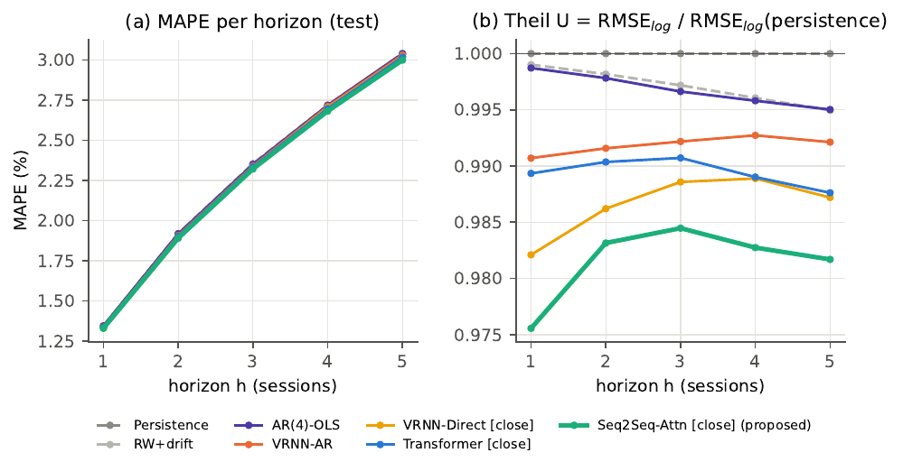
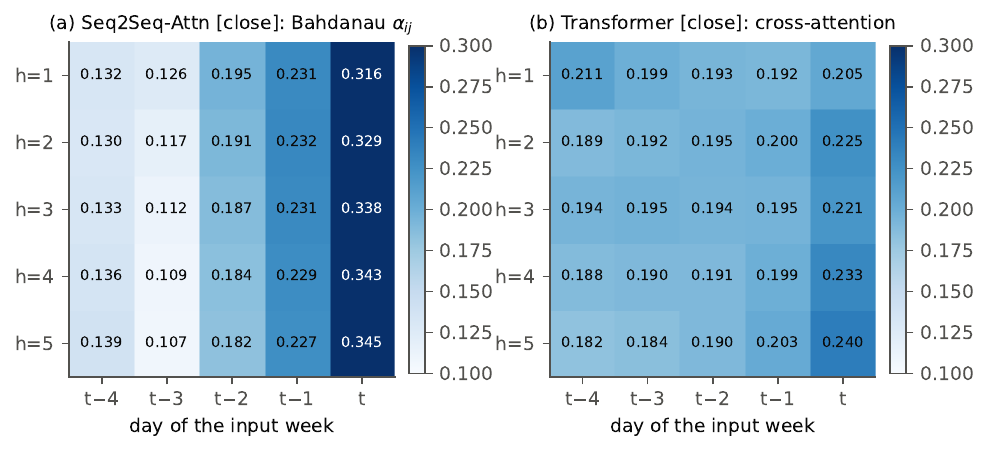
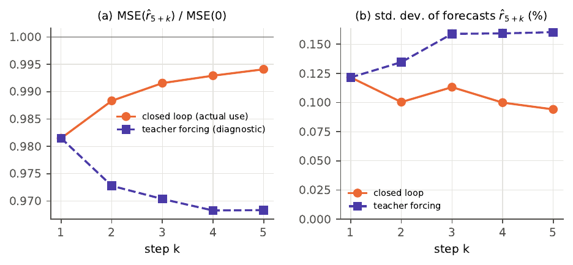

# Next-week closing-price forecasting on the Athens Stock Exchange

**Attention-based sequence models versus an autoregressive Vanilla RNN, evaluated against a random-walk benchmark with Diebold–Mariano tests.**

[](https://github.com/USERNAME/athex-weekly-forecasting/actions/workflows/tests.yml)


📄 **Technical report:** [`docs/TR.pdf`](docs/TR.pdf)

---

## Overview

Given **one week (5 trading sessions)** of prices of a stock, predict the **5 closing prices of the next week**.
Data: two years of daily OHLCV prices (13/05/2024 – 13/05/2026) of 25 anonymised Athens Stock Exchange stocks,
split **by stock** into training (17), validation (3) and test (5) sets.

The project covers the full workflow of a forecasting study:

- **Exploratory analysis** – ADF unit-root tests, ACF and Ljung–Box tests, day-of-week seasonality with harmonic regression.
- **Leak-free problem formulation** – sliding 5+5-session windows, anchored and scaled log-ratios with an exact inverse.
- **12 predictors** – 5 classical baselines (persistence, random walk with drift, linear trend, exponential smoothing, AR(4)) and
  4 neural families (autoregressive Vanilla RNN, direct Vanilla RNN, encoder–decoder GRU with Bahdanau attention,
  Transformer with learned horizon queries), the neural ones with close-only and OHLCV inputs.
- **Strict protocol** – hyper-parameters and the final model are chosen on the validation stocks only; 5-seed ensembles;
  the test set is used once.
- **Statistical evaluation** – MAPE, RMSE, Theil's U, directional accuracy, Diebold–Mariano tests with cross-sectional
  averaging, Newey–West variance and the Harvey–Leybourne–Newbold correction.

## Key results (test set, 5 unseen stocks, 2,430 windows)

| Model | MAPE (%) | Theil U | MSE vs persistence |
|---|---:|---:|---:|
| Persistence (random walk) | 2.275 | 1.0000 | — |
| RW + drift | 2.275 | 0.9964 | −0.7% |
| AR(4)-OLS | 2.274 | 0.9962 | −0.8% |
| VRNN-AR (required baseline) | 2.265 | 0.9921 | −1.6% |
| VRNN-Direct | 2.258 | 0.9874 | −2.5% |
| Transformer | 2.258 | 0.9891 | −2.2% |
| **Seq2Seq + Bahdanau attention (proposed)** | **2.245** | **0.9823** | **−3.5%** |

- The proposed model has the lowest error on every metric and the lowest Theil U at every horizon, and it is the only
  model that beats persistence significantly at the 5% level (Diebold–Mariano, *p* = 0.022).
- The gain is small, as expected for prices close to a random walk: daily returns are nearly white noise, so the
  next-week mean is barely predictable. The report discusses this and the checks where the gain is not significant.

<p align="center">
  
</p>

## What the models learned

| Attention decays into the past | Exposure bias of the recursive RNN |
|---|---|
|  |  |

- **Bahdanau attention** puts most weight on the most recent days (≈0.33 on the last day), much like the weights of
  exponential smoothing, but learned from the data.
- **The autoregressive baseline** loses its advantage after the first step: fed with its own smooth forecasts
  (closed loop) it drifts back towards the naive forecast, while with the true past returns it would keep improving.

## Method in brief

```
input week C1..C5 ──► z_t = log(C_t / C5) / s ──► model ──► ŷ_h ──► Ĉ_{5+h} = C5 · exp(s · ŷ_h)
```

- **Target:** `y_h = log(C_{5+h} / C_5) / s`, `h = 1..5`; `s` = std of daily log-returns of the training stocks.
  Persistence corresponds to `ŷ = 0`, and every network starts from it (zero-initialised output layer).
- **Baseline (required):** Vanilla RNN on daily returns, trained with teacher forcing and forecasting in closed loop.
- **Proposed:** bidirectional GRU encoder + GRU decoder with additive (Bahdanau) attention, trained free-running
  (no train/test mismatch).
- **Selection:** the attention model with the lowest validation MSE of its 5-seed ensemble, fixed before touching the test set.

## Repository structure

```
├── data/{train,validation,test}/*.csv   # input data (17 / 3 / 5 stocks)
├── stockcast/                           # library code
│   ├── config.py      problem definition, training settings, hyper-parameter grids
│   ├── data.py        loading, windowing, invertible transformations
│   ├── baselines.py   Persistence, RW+drift, linear trend, SES, AR(4)-OLS
│   ├── models.py      VRNN-AR, VRNN-Direct, Seq2Seq-Attn, Transformer
│   ├── train.py       training loop, early stopping on the 5-step validation forecast MSE
│   ├── metrics.py     metrics and Diebold–Mariano test
│   └── plotstyle.py   figure style
├── run_eda.py         exploratory analysis
├── run_tuning.py      hyper-parameter search on the validation stocks
├── run_final.py       final training (5 seeds per model) and forecasts
├── run_evaluation.py  model selection, test evaluation, figures
├── run_all.sh         end-to-end pipeline
├── tests/             sanity checks (no look-ahead, exact inversion, DM symmetry, ...)
├── report/            LaTeX source of the report (numbers and tables generated from results/)
├── results/           tables, figures, forecasts and trained weights used in the report
└── docs/              compiled report and README figures
```

## Quick start

```bash
git clone https://github.com/USERNAME/athex-weekly-forecasting.git
cd athex-weekly-forecasting
python -m pip install -r requirements.txt

python -m pytest -q            # sanity checks
python run_evaluation.py       # re-evaluates the stored forecasts and weights (no training, ~1 min)
bash run_all.sh                # full reproduction from scratch (~1.5 h on a 2-core CPU, no GPU needed)
```

Rebuild the report: `python report/make_report_assets.py && cd report && xelatex TR.tex && xelatex TR.tex`.

## Reproducibility

- Fixed seeds and `tf.config.experimental.enable_op_determinism()`: retraining a model reproduces the stored forecasts exactly.
- Every number and table in the report is generated from `results/` by `report/make_report_assets.py`.
- Tested with Python 3.11, TensorFlow 2.21 / Keras 3.15 on CPU (exact versions in `requirements.txt`).

## Citation

If you use this code, please cite it using the metadata in [`CITATION.cff`](CITATION.cff).

## License

The code is released under the [MIT License](LICENSE). The data in `data/` were provided for the course and are not covered by this license.

## Acknowledgements

Course project for *Time Series Analysis and Applications*, MSc in Data Science and Information Technologies (DSIT),
National and Kapodistrian University of Athens, Spring 2026.
